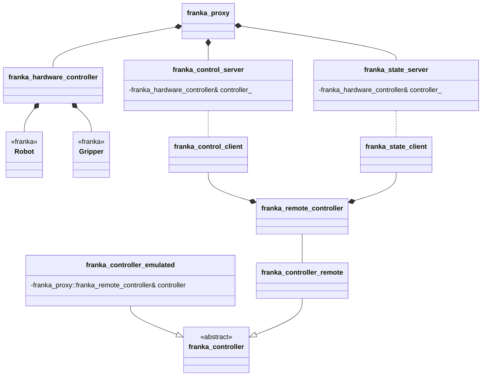

# Setup

## Using the Project

This project consists of two components:

- A client/controller library for integration into your own project.
- A server application that runs on the computer connected to the Franka Emika robot.

Both components are typically installed via `vcpkg`. You can either use the provided overlay ports in `./tools/vcpkg-overlay-ports/` or, if available to you, the internal AI3 `vcpkg` fork:
https://resy-gitlab.inf.uni-bayreuth.de/tools/vcpkg.git

### Installation

- To install the client library:
  ```vcpkg install franka-proxy --overlay-ports=<insert/path/here>/franka_proxy/tools/vcpkg-overlay-ports```

- To install the server and test applications:
  ```vcpkg install franka-proxy[server,tests] --overlay-ports=<insert/path/here>/franka_proxy/tools/vcpkg-overlay-ports```

Note: Ensure that the client and server use the same port version. Compatibility is not guaranteed otherwise.

---

# Building from Source

## Installing Dependencies via vcpkg

Use `vcpkg`:
```
./bootstrap-vcpkg.sh
vcpkg install asio argparse eigen3 franka nlohmann-json poco
```

## Using CMakePresets

If you plan to use CMakePresets, copy `./tools/CMakePresets.json` to the project root directory (next to `CMakeLists.txt`). Modify the `common-config` to specify the correct `CMAKE_TOOLCHAIN_FILE` and compiler. Then build:
```
cmake --preset windows-release
cmake --build ./out/build/windows-release --config windows-release
```

## Manual Build

To build without presets:
```
mkdir build
cd build
cmake .. "-DCMAKE_TOOLCHAIN_FILE=<insert/path/here>/vcpkg/scripts/buildsystems/vcpkg.cmake"
cmake --build .
```

---

## Python Bindings

To generate Python bindings, the loose steps are:

1. Install `pybind11` via `vcpkg`.
2. Enable `BUILD_PYTHON_CONTROLLER` option in CMake chache and reconfigure the project.
3. Build the project in `Release` mode.
4. Run `controller_test.py` located in `<build_dir>/python`.

---

## Diagnosing `move_sequence` timing

Timing logs are **automatic** on every remote `move_sequence()` call. No new Python
API or flag is needed. They go to **stderr**, prefixed `[move_sequence]`. The client
and proxy write to their own terminals; save **both**. Motion, thresholds, P2P
bracketing, and GIL behavior are unchanged.

### Rebuild before the lab run

Rebuild **both** the Python module and proxy from this source checkout, not just
one of them. The vcpkg `franka-proxy` overlay fetches a pinned upstream revision;
reinstalling that package does not build these local changes.

On the already-configured Windows lab checkout, enable the binding and offline test:

```powershell
cmake -S . -B build -DBUILD_SERVER=ON -DBUILD_TESTS=ON -DBUILD_PYTHON_CONTROLLER=ON
just build
just test
```

This reuses the existing build's vcpkg toolchain and Python interpreter. A fresh
checkout still needs the toolchain configuration described above. Without `just`,
use `cmake --build build --config Release` and
`ctest --test-dir build -C Release -R '^sequence_timing_offline$' --output-on-failure`.
`just test` runs only hardware-free timing checks, never the robot-facing examples.
On Linux the justfile defaults to `out/build/linux-release`; override a custom path
with `just --set build_dir PATH build` (or `test`).

For the existing Windows layout, point the client at the rebuilt binding:

```powershell
$env:PYTHONPATH = "$PWD\build\python;$env:PYTHONPATH"
& 'C:\Users\ribeiro\vcpkg\installed\x64-windows\tools\python3\python.exe' -c "import py_franka_control as p; print(p.__file__)"
```

That import is hardware-free. Verify it prints this checkout's `build\python`
module. Launch the rebuilt `build\packages\franka_proxy\Release\franka_proxy.exe`,
not an older vcpkg-installed executable, **only after the operator's usual safety
checks and approval**. Do not use `controller_test.py` as a physical profiling
probe: its remote example contains hardcoded motion and gripper commands.

### Capture and interpret

In PowerShell, append `2>&1 | Tee-Object -FilePath proxy-timing.log` to your usual,
operator-approved proxy launch. Append `2>&1 | Tee-Object -FilePath client-timing.log`
to your usual client launch in its separate terminal. Use fresh filenames per run.
The pipeline suffixes are not standalone commands. On Linux, the equivalent suffix
is `2>&1 | tee FILE.log`. Run a small approved batch before collecting a longer run
and confirm that **both** logs contain `[move_sequence]` lines.

| Log field/phase | What it separates |
|---|---|
| Client `prepare` | Native array conversion and optional offset FK/IK |
| Client `leading_p2p`, `core_sequence`, `trailing_p2p` | Each blocking RPC, including serialization, network, and server work |
| Client `native_total` | Entire native method; excludes Python planning and pybind argument conversion |
| Server `generator_setup` | Sequence copies, model loading, and generator initialization |
| Server `state_handoff` | Control-loop state handoff and state-mutex wait |
| Server `control` | Wall time inside `robot.control()`, including entering/exiting the session |
| Server `sequence_total` | Whole hardware method, including generator destruction and existing CSV output |
| `nominal_ms`, `callback_elapsed_ms`, `progress_ms` | Sample-count duration, sum of actual callback periods, and controller trajectory clock |
| `stalled_callbacks`, `stall_episodes`, `stall_ms`, `longest_stall_ms` | 5 mm tracking-clamp activity; durations sum the actual periods of flagged callbacks |
| `clock_rewind_ms`, `max_period_ms` | Actual fixed 1 ms rewinds versus the largest callback period |
| `peak_error_mm`, `last_error_mm` | Translation tracking error **before** clamping |

The tracking summary and start/end joint snapshots are printed **after** control
returns or unwinds. New callback instrumentation uses fixed-size counters/copies,
not per-tick printing or growing buffers. `sequence_q` is the raw joint target
before an optional Cartesian offset; `robot_q_d` is libfranka's desired joint state.
`last_step` is zero-based. A `finished` callback does not prove endpoint convergence;
inspect the last error and trailing P2P too. `status=returned` means no escaping
exception, not guaranteed success (a requested stop is caught by existing code).
`unwinding=1` marks a generator being destroyed during exception propagation.

Start/end events expose the last entered phase even if execution hangs. IDs are
**process-local**, not transmitted over the network: correlate a single client's
batches by order and sample count, not by assuming client/server IDs always match.
Durations are monotonic; phase totals are nested and must not all be added together.
Large `control` minus `callback_elapsed_ms` suggests session overhead; large callback
time minus trajectory progress with many stalls implicates tracking, not P2P.
These are diagnostics, not a timing fix or robot validation.

## Project structure

